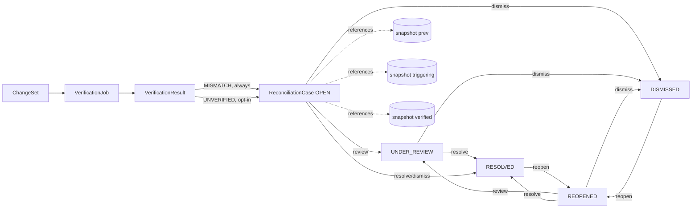

# Hospital Intelligence Platform — Architecture

The extractor has evolved from a website-only crawler into a **source-agnostic
hospital intelligence platform**: any registered data source is normalized into
one canonical `HospitalDataset`, stamped with record-level provenance, compared
dimension-by-dimension, persisted to a SQLite store, and (optionally) prepared
for a government submission — all without taking a shortcut around the
original 25-field intake contract.

This document describes the architecture added after the comparison engine and
the terminology the code uses.  The original pipeline (crawler → extraction →
processing → export) is unchanged and documented in the README.

## Source abstraction

```
                          ┌──────────────────────┐
   hospital website ──►   │ HospitalDataSource   │
   mock/demo API    ──►   │  (ABC)               │   canonical Provenance:
   authorized API   ──►   │  fetch() ->          │   SourceIdentity + record-level
   JSON feed file   ──►   │    HospitalDataset   │   source_type per entity
                          │  acquire() ->        │
                          │    AcquisitionResult │
                          └──────────┬───────────┘
                                     ▼
                        harvest() pipeline (async)
                                     ▼
                     compare / persist / export / serve
```

- `sources/base.py` — `HospitalDataSource` ABC + the canonical entity-field registry.
- `sources/registry.py` — `SourceRegistry` maps `source_type` strings to
  factories from `config/sources.toml` (or programmatic registration) and
  carries a `SourceDefinition` per type (display name, `simulated`,
  `requires_authorization`) so consumers ask "is this source simulated?"
  instead of hard-coding source values.
- `sources/website.py` — the unchanged website path, wrapped as a DataSource.
- `sources/mock_api.py` / `hospital_api.py` / `json_feed.py` — adapters.
- `sources/api_mapping.py` — strict payload→canonical mapping
  (`map_api_payload_to_dataset`), shared by all API-style adapters; rejects
  malformed payloads with `MalformedPayloadError`.
- `sources/pipeline.py` — `harvest()` (async orchestrator) + `run_harvest()`
  (sync wrapper); aggregates per-source failures into `HarvestError`.

### Provenance contract

Every record (hospital, doctor, procedure, …) carries a `source_type` string
(`website`, `hospital_api`, `mock_api`, `json_feed`).  The dataset carries a
`SourceMetadata` block:

- `source_id`, `source_type`, `provider`, `base_url`
- `hospital_ref`, `hospital_name` (which hospital this source talks about)
- `retrieved_at`, `status` (`fetched | failed | skipped | simulated`)

Provenance is set once, in the adapter, and flows untouched through
comparison, storage, exports and the API.  No consumer has to guess where a
fact came from.

## Comparison with provenance and conflicts

P8 adds two guarantees to the comparison engine:

1. **Provenance survives**: `EntityMatch` and `ComparisonEvidence` carry
   `source_type` (default `"website"`, backward compatible).  The matcher
   stamps matches from the underlying record; dimension builders copy it into
   evidence.

2. **Conflicts are surfaced, never silently resolved**: `SourceConflict`
   (`comparison/models.py`) records a dimension with *real* evidence items
   whose decisions disagree (e.g. a `yes` from one source and a `no` from
   another).  `detect_dimension_conflicts()` fills `DimensionResult.conflicts`;
   the UI renders a “Conflicting evidence — no winner picked” panel with every
   contributing fact.

Rules that remain invariant:

- Absence of evidence is NEVER a negative claim (absence → `unknown`).
- Only real evidence (`text != NO_EVIDENCE_MESSAGE`) counts toward conflicts.
- A mixed `yes`+`unknown` set is not a conflict.

## Persistence (SQLite store)

`storage/database.py` — `HospitalDatabase`:

- `datasets` table holds the canonical `model_dump_json()` payload (the single
  source of truth, Pydantic round-trips it back).
- `sources` and `records` tables are query-oriented mirrors (indexed by
  `source_type`, `category`, `name`) for fast listing / search.
- API: `save_dataset`, `load_dataset`, `list_datasets`, `search_records`,
  `delete_dataset`.  All SQL is parameterised.

> TODO (P19+): `list_datasets` / `list_hospital_sources` currently read the
> full `payload` column per row purely to surface `quality.records_extracted`.
> Acceptable at demo scale; do not add columns/mirrors until a real
> performance requirement exists.

## Exporters

`exporters/` — `DatasetExporter` ABC with `ExportArtifact` / `ExportResult`.
`GovernmentPortalExporter` writes a `submission.json` + `manifest.json`
(simulated, `dry_run: true`, `submitted_at: null`) plus a sha256 integrity
check.  CLI: `hospital-extractor ... --gov-export`.

## Service layer (API)

- `GET  /` and `POST /compare` (HTMX) — the original comparison UI, now with a
  Data Source selector and a **Demo Mode** banner.
- `POST /api/v1/compare` — JSON comparison; body gains a `source` field.
- `GET  /hospitals/` — stored-hospital gallery (HTML).
- `GET  /hospitals/{dataset_id}` — one hospital profile with source badges.
- `GET/POST/DELETE /api/v1/hospitals*` — list / read / import / delete over
  the SQLite store.  Comparisons persist their inputs automatically.

## Demo mode

- `medcompare-demo-server` (or `python -m hospital_extractor.mockapi`) runs a
  **fully simulated** hospital API on `127.0.0.1:8001` serving two fictional
  facilities — `demo-northstar` and `demo-solstice`.
- The web form’s “Load demo comparison” prefills the mock source.  Every demo
  endpoint and UI banner is labelled SIMULATED; demo data must be verified
  before any real use.
- The slickest demo path is source-agnostic: the same
  `POST /api/v1/compare` that crawls websites also consumes the demo API and
  persisted JSON feeds with zero consumer changes.

## End-to-end source-agnostic validation (P18)

The same canonical pipeline now provably serves **every** source type.  This
was validated end-to-end in `tests/test_integration_sourceagnostic.py`, not by
unit shortcuts:

- **Real website path**: a local `http.server` thread serves the standard
  six-page fixture site; `WebsiteDataSource` crawls and extracts it (measured
  crawl+extract ≈ 1.1 s on the dev machine), producing the same canonical
  `HospitalDataset` the live CLI produces.
- **Mock API path**: the demo ratings endpoints are served in-process over an
  ASGI transport; `MockHospitalAPIDataSource.fetch()` returns the same
  canonical shape.  Both paths persist to the same SQLite store and compare
  with the same engine on the same dimension labels.
- **Cross-source conflict**: real `yes` (website) + real `no` (mock) on the
  same procedure → `CONFLICT` (decision `unknown`, both source badges shown,
  no winner picked).  `yes`+`unknown` → `yes`; `no`+`unknown` → `no`, neither
  is a conflict.

### Hospital identity across sources (`hospital_key`)

Two sources describing one hospital are grouped by `hospital_key`
(`storage/database.py`):

- `hospital_key` = slug of the hospital name (fallback: `hospital_ref`, then
  `source_url`, then `"unknown"`), capped at 64 chars.
- `datasets.hospital_key` is added by additive migration for pre-P18
  databases; API listing accepts `?hospital_key=`; the profile page lists
  "Other sources for this hospital".
- `dataset_id` is scoped per (hospital, source, ref) so distinct captures
  never collide, and re-saving a capture within a second upserts (single
  latest row for that hospital+source).
- `sources.source_id` is scoped to its owning `dataset_id` (the source id
  derives from the provider, which is shared across hospitals); `records`
  mirrors the same scoped id so the two provenance tables always agree.

> **Resolved in P19-A — canonical hospital identity.** An opaque `h_…` id
> (``hospitals`` registry + ``hospital_aliases`` table) is the ONE canonical
> identity; `hospital_key` remains a compatibility grouping key and `dataset_id`
> a per-(hospital, source, ref) row key.  Resolution is read-only-exclusive
> (:meth:`find_hospital_id` never mints), identity is assigned on write from
> the per-source `hospital_ref` (never from the name), and writes resolve by
> source ref so two genuinely distinct hospitals sharing a name never collapse
> silently — cross-source reconciliation is a later phase (P19-C).  See
> “Snapshots & change detection (P19-A)” below.

### Conflict semantics (exact)

- Conflict ⇔ real evidence contains **both** a `yes` and a `no`.
- `yes`+`unknown` → `yes`; `no`+`unknown` → `no` (never a conflict).
- Absence of evidence is NEVER a negative claim (absence → `unknown`).
- On conflict the merged dimension decision is `unknown` and every
  contributing fact is surfaced in the UI — there is no silent winner.

### Demo harness

`hospital-extractor integration-demo` runs the whole stack in-process
(ASGI → mock API → canonical dataset → SQLite → comparison UI data) and prints
per-source timings, ending in the same comparison view the web UI renders.

## Snapshots & change detection (P19-A)

Foundation for the P19-B verification workflow.  Everything here is **read +
explicit capture only** — nothing schedules, notifies or submits.

### Canonical hospital identity

- `hospitals.hospital_id` is an opaque `h_…` id minted once per hospital.
- `hospital_aliases(alias_type, hospital_id)` maps a hospital to zero-to-many
  read aliases: `source_ref` (slug of the per-source `hospital_ref`) and
  `name_slug` (slug of the hospital name).  The PK is
  `(alias_type, hospital_id)` so **several hospitals may share one alias
  value** (e.g. the same name from two sources) — the alias lookup
  (`find_hospital_id`) resolves only when exactly ONE hospital owns it and
  fails closed otherwise.
- Write path (`hospital_id_for`): resolve `preferred` (an already-registered
  `h_…`) → `source_ref` → mint new.  Names are registered as aliases but never
  resolve on write, so two distinct hospitals with the same name stay separate
  histories; `hospital_key` and `dataset_id` remain the compatibility /
  per-(hospital, source, ref) keys they always were.
- `datasets` gains an additive `hospital_id` column; pre-P19-A databases are
  migrated and backfilled in place.

### Snapshot model

- A snapshot is one immutable capture of a hospital's canonical
  `HospitalDataset` from one source: `snapshots` rows (``s_…`` ids) store the
  full canonical JSON as truth alongside `hospital_id`, `source_type`,
  `captured_at`, `content_hash` and `status`.
- The mutable `datasets` table is unaffected — it stays the “latest dataset
  per (hospital, source, ref)” view.

### Content fingerprint

`canonical_digest` is a SHA-256 over a deterministic serialization of **semantic
content only**:

- In scope: hospital/contacts/infrastructure fields and the member sets of the
  collection categories (sorted → order-insensitive).
- Excluded: `dataset.source`, `dataset.quality`, the `sources` provenance
  worksheet, and every per-record provenance field (`source_url`, `page_url`,
  `page_title`, `extracted_at`, `source_type`, `context`, `extraction_method`,
  `source_strength`, `confidence`).

Two captures of the same hospital+source are “no change” iff their digests
match; the digest contract is exercised directly in `test_fingerprint.py`.

### Change detection

`compute_changes` compares two canonical datasets identity-keyed and
field-aware:

- Collections are matched by stable identity — named entities by `name`,
  doctors prefer `profile_url`, single-record categories by the fixed
  `primary` key.  Order never produces changes.
- A changed field becomes one `MODIFIED` (`path = category.field`,
  `None → value` counts); new/vanished items become `ADDED` / `REMOVED` with
  `entity_name`; every change is stamped with the new state's provenance
  (`source_type`, `provider`, `captured_at`, `source_url`) so it remains
  auditable.
- First-snapshot semantics: the first capture of a hospital+source is reported
  as `initial_snapshot` with **zero** changes (an empty database is not a
  flood of “added” entries).

Change-set **statuses** are limited to what P19-A can observe:
`initial_snapshot`, `no_change`, `changes_detected`.  `VERIFIED`, `NOTIFIED`
and `GOVERNMENT_SUBMITTED` are documented for P19-B+ but NOT modelled here.

### Storage & idempotency

- `snapshots` (immutable payloads) + `change_sets` (`c_…`, persisted payload
  JSON + denormalised counts) are additive tables.
- `save_snapshot(dataset)` is **idempotent**: when the latest snapshot of the
  same (hospital, source) already carries the digest, no row is written and a
  `no_change` change set referencing the existing snapshot is returned.
- Captures are explicit (`POST /api/v1/hospitals/{id}/capture`,
  `hospital-extractor capture`) — no cron / worker / webhook exists.

### Read models

- `GET /api/v1/hospitals/registry` — canonical identities with counts.
- `GET /api/v1/hospitals/{id}/snapshots` (by `h_…` id, source ref, or unique
  name) — history, newest first, optional `?source_type=`.
- `GET /api/v1/hospitals/{id}/changes` — audit trail with counts.
- `GET /api/v1/snapshots/{snapshot_id}` — full immutable payload.
- Profile page gains a **Data history** section (latest snapshot per source,
  snapshot + change-set counts, recent change sets).
- CLI: `capture`, `snapshots <hospital>`, `changes <hospital>`, `hospitals`
  (all read-only except `capture`, and all offline-testable via `json_feed`).

### Same-source histories stay separate

Per-source snapshot lineages are keyed by `(hospital_id, source_type)`.  Two
**different** sources describing the same hospital do not automatically share
one identity in P19-A (unless they share a source ref) — reconciling them is a
deliberate P19-C decision, never a silent side-effect.

## Verification workflow (P19-B)

P19-A records *that* something changed; P19-B proves *it really happened* by
re-checking the changed facts against the published target (by default the
hospital's own website) and persisting the verdict.  Everything here is
**explicit + background**: the worker is only ever started on demand, request
handling never waits on a capture, and normal reads (profiles, search,
comparisons, history) touch the database only.  Nothing submits or notifies in
P19-B.

### ChangeSet vs Job

- A **ChangeSet** is a record of what changed between two captures (P19-A).
- A **VerificationJob** is a promise that those changes *should* be checked
  against a target source.  Different change sets → different jobs; the same
  event never creates two jobs.

```
   authoritative capture
   (docs. changes)          ChangeSet ─► VerificationJob ─► worker
        │                            (idempotent per     │  claim (PENDING→RUNNING)
        │                            event+target)       ▼
   schedule_job_for_capture                           target capture
                                                        (FULL dataset,
                                                         explicit only)
                                                             │
                                                         evaluate ONLY the
                                                         triggering changes
                                                             │
                  ┌────────────────────────────────────────┴───────────────┐
                  ▼                                                         ▼
           VerificationResult                                    job outcome
        status + sent per change                            VERIFIED/MISMATCH/UNVERIFIED
        (+ captured target snapshot)                        → complete | requeue | FAILED
```

### Scheduling rules (the capture hook)

- `schedule_job_for_capture(db, capture)` runs at the end of an authoritative
  capture (`POST .../capture`, CLI `capture`).  Only
  `changes_detected` change sets schedule a job; `initial_snapshot` and
  `no_change` never do.
- A capture whose own source **is** the target source never schedules — the
  website verifying itself is meaningless.
- `target_ref` prefers the hospital's own `website` URL, then its `source_url`,
  then the source `hospital_ref` (`build_target_ref`).
- `create_manual_job(db, hospital_id, ...)` is the explicit testing/demo hook
  (API `POST`, CLI `verify`); it targets the most recent eligible
  `changes_detected` set and is idempotent.  It returns "nothing to verify"
  when no such set exists.
- Idempotency is enforced by the `UNIQUE (change_set_id, target_source_type)`
  index in `storage/database.py`, not by app-level dedup.

### The worker

- `run_worker_cycle(...)` (async) processes every due job once
  (`scheduled_for <= now`, oldest first); `run_worker_forever(...)` is the CLI
  `worker` loop.  Each job is claimed atomically
  (`PENDING → RUNNING`, `attempt_count + 1`) so concurrent local workers
  never double-run a job.
- The target source is captured as a **full dataset** through the registered
  source adapter (`_registry_capture` / an injected `CaptureFn`); verification
  makes no claim-by-claim targeted crawling.
- Only the triggering changes are evaluated (`evaluate_change_set`), so a
  website that drifted elsewhere does not taint the verdict.
- The successful run writes a target **snapshot** (same immutable
  `snapshots` table) + a **VerificationResult** row, then completes the job.

### Evaluation rules

Entities are identity-matched the same way P19-A detects changes.  Outcomes:

| Change kind        | Target source shows                | Outcome     |
| ------------------ | ---------------------------------- | ----------- |
| ADDED              | the added entity/field             | VERIFIED    |
| ADDED              | nothing for it                     | UNVERIFIED  |
| REMOVED            | it is gone                         | VERIFIED    |
| REMOVED            | it is still present                | MISMATCH    |
| MODIFIED / None+None | equal value                      | VERIFIED    |
| MODIFIED / None → "value" | target silent (None)        | UNVERIFIED  |
| MODIFIED           | value differs                      | MISMATCH    |

Aggregation: any **MISMATCH** wins; otherwise all-VERIFIED → **VERIFIED**;
anything else → **UNVERIFIED**.  Absence of evidence is never a negative
claim — a silent page is UNVERIFIED, never "confirming" a removal.

### Retries, backoff and failure states

- On retryable failure (harvest/source errors, exceptions) the job is
  re-queued to `PENDING` with `scheduled_for = now + max(1, attempt_count) ×
  backoff_minutes`; when `attempt_count >= max_attempts` (default 3, backoff
  2) it is **FAILED**.
- Permanent/configuration failures fail immediately: missing target ref, no
  registered adapter for the source type, and anything requiring an
  authorization the platform does not have yet.
- **Authorization boundary**: a target source whose `SourceDefinition`
  marks `requires_authorization` (e.g. `hospital_api`) is rejected with
  `VerificationPermanentError` *before any capture is attempted* — the job
  is marked FAILED with an explanatory error and no private endpoint is ever
  touched until P19-D.
- A `FAILED` job produces no `VerificationResult`; the error trails on the job
  row.

### Settings

`VerificationSettings` (frozen dataclass, `verification_settings(**overrides)`):
`delay_minutes` (cooldown before a change may be verified), `max_attempts`,
`backoff_minutes`, `worker_interval_seconds`, `target_source_type`.
Environment fallbacks `VERIFICATION_DELAY_MINUTES` /
`VERIFICATION_MAX_ATTEMPTS` / `VERIFICATION_BACKOFF_MINUTES`; defaults keep
`delay_minutes = 0` so tests and the demo never sleep, while a deployment sets
a positive cooldown via `--delay-minutes`.

### Surfaces

- **CLI**: `verify <hospital>`, `verification-jobs <hospital>`, `worker`
  (`--once`, `--max-attempts`, `--backoff-minutes`, `--delay-minutes`,
  `--interval`, `--log-level`), `verification-demo`.
- **API**: `GET/POST /api/v1/hospitals/{id}/verification-jobs`,
  `GET /api/v1/verification-jobs/{job_id}` (404 on unknown), manual POST is
  idempotent and returns 409 when nothing is eligible.  `api_capture_snapshot`
  includes the scheduled `verification_job` in capture responses.
- **UI**: the profile page renders a "Verification status" panel per job
  (badges + counts); raw change JSON never reaches the template.
- **Demo**: `verification-demo` runs an offline, deterministic walkthrough —
  Scenario A: a new procedure on `demo-northstar` is present on its simulated
  website → `VERIFIED`; Scenario B: `demo-solstice` beds 420→450, website
  unchanged → `MISMATCH`.

## Reconciliation workflow (P19-C)

P19-B proves a change happened; P19-C answers **“what should we do with it?”**
A verification verdict that needs human judgement becomes a persistent
**ReconciliationCase** the platform surfaces and lets a person walk through.
This is deliberately *not* an automatic data-fix pipeline: a resolution records
a decision **about the evidence**, and nothing is ever written back to any
hospital source.



### Case creation policy (idempotent)

At most one case exists per verification result — enforced by a **unique index
on `verification_result_id`** in storage, not app-level dedup — so reprocessing
a result never duplicates a case and **reopening never mints a new one**.

| Verification status | Auto-created case? |
| --- | --- |
| `MISMATCH` | **always** (the worker opens it as the job completes, actor `system`) |
| `UNVERIFIED` | only when `ReconciliationSettings.create_cases_for_unverified` is on (env `RECONCILIATION_CREATE_UNVERIFIED_CASES=1`) |
| `VERIFIED` / `FAILED` | never automatically |
| any (manual) | `create_manual_case(...)` — explicit request, also allows `VERIFIED` |

Each case carries **field-level items** derived from the triggering
`ChangeVerification`s (path / category / entity / field, the previous +
authoritative + verified values), so a reviewer sees exactly which dimensions
disagree instead of a flat “something changed”.

### State machine

`ALLOWED_TRANSITIONS` (in `reconciliation/models.py`) is the sole source of
truth; `reconciliation/service.py` enforces it and raises
`ReconciliationStateError` on anything else (API maps it to HTTP 409):

- `OPEN → UNDER_REVIEW | RESOLVED | DISMISSED`
- `UNDER_REVIEW → RESOLVED | DISMISSED`
- `RESOLVED → REOPENED` (only)
- `REOPENED → UNDER_REVIEW | RESOLVED | DISMISSED`
- `DISMISSED → REOPENED` (only)

Resolutions (`ResolutionType`) describe the *decision about the evidence*, not
a claim of “which source is truth”:
`authoritative_source_confirmed`, `website_confirmed`, `source_disagreement`,
`insufficient_evidence`, `false_positive`.  Resolving and dismissing require an
explicit reason; reopening clears the previous decision (the audit trail keeps
it).

### Audit trail

Every transition appends a `ReconciliationEvent`
(`reconcil-action` = `created` | `review_started` | `resolved` | `dismissed` |
`reopened`) with actor, reason, from/to status and timestamp, stored in
insertion order.  A case's full history is therefore read-only evidence.

### Evidence package

`build_evidence_package(db, case)` returns *references* — not copies — to the
existing immutable snapshots (snapshot id, source, provider, captured_at,
status, content hash) together with the ChangeSet, VerificationJob and
VerificationResult JSON.  No historical payload is duplicated, mutated or
overwritten.

### Guarantees

- No hospital data is written back to any source; snapshots stay immutable.
- Source identities are preserved — a case *connects* sources, it never merges
  their lineages.
- The same verification result never yields two cases; reopening reuses the
  same case.
- No private/authorized endpoint is ever touched (inherited from P19-B).

### Surfaces

- **Storage**: additive `reconciliation_cases` + `reconciliation_events` tables
  (`create/get/list/update` + event append; CRUD idempotent on the result key).
- **CLI**: `reconciliation-cases <hospital>`, `reconciliation <case_id>`,
  `review`, `resolve --resolution … --reason …`, `dismiss`, `reopen`.
- **API**: `GET /api/v1/hospitals/{id}/reconciliation-cases`,
  `GET /api/v1/reconciliation-cases/{case_id}` (with evidence + events),
  `POST …/{case_id}/review|resolve|dismiss|reopen` (404 unknown, 409 invalid
  transition, 422 missing reason/resolution).
- **UI**: profile page gains a "Reconciliation" panel; each case has a review
  screen at `/reconciliation-cases/{case_id}` with a server-side action form.
- **Demo**: `verification-demo` now has three scenarios — A **verified** (no
  case), B **mismatch** → case → review → resolve, C **unverified** (opt-in) →
  reviewable open case.

## Continuous monitoring (P20)

P19-A..E capture and verify on demand; P20 adds **scheduled** capture.  A
monitoring policy is a persistent row keyed by the canonical `hospital_id`
(never a display name) plus `(source_type, target_ref)`, carrying a fixed UTC
schedule — `hourly`, `daily` or `weekly` (no cron parser, no calendar/timezone
database; weekly means +7 days from the reference instant).

```
   monitoring_policies ──► worker cycle ──► claim (PENDING→RUNNING)
         │                                       │
         │                                       ▼
         │                          orchestration (P19-E, idempotent key)
         │                                       │
         │                    ┌──────────────────┴──────────────────┐
         │                    ▼                                     ▼
         │             change detected?                        no_change?
         │                    │                                     │
         │              verification etc.                    short-circuit
         │              (existing P19-B..D)                  (no duplicate
         │                    │                               work; monitoring
         └──── complete ◄────┴──── records outcome ──── fail/requeue ◄──┘
               next_run_at = +interval                   backoff → FAILED
```

### Guarantees

- **Reuses orchestration, never reimplements it.**  Each due policy claims
  atomically and delegates to `run_orchestration` under a deterministic
  idempotency key (`monitoring:{policy_id}:{window}`), so reprocessing the
  same window is a no-op.  A `no_change` orchestration short-circuits inside
  orchestration itself — monitoring only records the outcome and computes the
  next schedule; it never re-runs verification/reconciliation/reporting on
  `NO_CHANGE`.
- **Per-policy in-flight protection.**  `claim` is a guarded
  `UPDATE … WHERE status='pending' AND enabled=1`; a second worker sees
  `rowcount == 0` and skips.
- **Bounded retries + backoff.**  Retryable failures re-queue with linear
  backoff (`backoff_minutes * consecutive_failures`); permanent errors and
  exhausted attempts go to `FAILED` (never retried forever).  `enable`
  resets a `FAILED` policy.
- **Bounded work per cycle.**  `max_policies_per_cycle` caps how many due
  policies one cycle claims.
- **Min interval floor.**  `min_interval_minutes` raises (never lowers) the
  next successful schedule so rapid enable/disable cannot create a tight loop.
- **Additive schema.**  `monitoring_policies` is created by the monitoring
  store via `CREATE TABLE IF NOT EXISTS` — `storage/database.py` is untouched
  (P19-E integrity), and both fresh databases and existing P19 databases work
  without a hand-written migration step.
- **No auth bypass.**  A policy may name an authorized source type
  (`hospital_api`), but monitoring only *schedules*; authorization is still
  enforced inside the existing verification/orchestration path.  The government
  provider stays mock/authorized-only.  **Limitation:** monitoring does not
  add provider credentials — an authorized source will fail closed until a
  real integration exists (documented, not silently bypassed).
- **Explicit worker.**  Nothing in the web UI or request path starts the
  monitoring worker; normal reads (profiles, listings) touch the database only.

### Surfaces

- **Storage**: `monitoring/monitoring.py` package (`MonitoringStore` with
  additive `monitoring_policies` table; CRUD + atomic claim/complete/fail).
- **CLI**: `monitoring list`, `monitoring add <hospital> --frequency …`,
  `monitoring enable|disable <policy_id>`, `monitoring run <policy_id>`,
  `monitoring worker [--once]`.
- **API**: `GET/POST /api/v1/hospitals/{id}/monitoring-policies`,
  `GET /api/v1/monitoring-policies/{id}`,
  `POST …/{id}/enable|disable|run` (404 unknown, 422 invalid source).
- **UI**: profile page gains a "Monitoring" panel listing policies with
  schedule, status, next run, last success/failure; the page never crawls.

## Search & field comparison (P22)

Reads canonical datasets already in the SQLite store.  Never re-crawls,
never ranks, never converts UNKNOWN into NO.

```
 Query / ComparisonRequest
          │
          ▼
 ┌────────────────────┐
 │ search/filters.py  │  resolve dotted path → (value, origin)*
 │  validate_field    │  matches_filter (deterministic operators)
 └─────────┬──────────┘
           ▼
 ┌────────────────────┐
 │ search/service.py  │  search_datasets / compare_stored_hospitals
 └─────────┬──────────┘
           ▼
 QueryResult / ComparisonResult   (hospital, field, value, evidence, captured_at)
```

### Typed models (`search/models.py`)

- `FilterOperator` — `equals | not_equals | contains | not_contains |
  exists | not_exists | in | not_in | gt | gte | lt | lte | after | before`
- `Filter` — `{field, operator, value}` (value required except exists/not_exists)
- `Query` — filters + optional free text + hospital_ids + limit/offset
- `QueryResult` — total + page of matches, each with hospital identity,
  source provenance, `captured_at`, and per-field hits + `EvidenceReference`
- `ComparisonRequest` — 2–4 unique `hospital_ids` + optional `fields`
- `ComparisonField` / `ComparisonFieldCell` — one field across hospitals;
  `unknown=True` means the field was not published (rendered UNKNOWN)
- `ComparisonResult` — side-by-side only; fixed `note` forbids ranking

### Filter semantics (UNKNOWN ≠ NO)

| Situation | `equals` | `not_equals` | `exists` | `not_exists` |
| --- | --- | --- | --- | --- |
| Value present, matches | ✓ | ✗ | ✓ | ✗ |
| Value present, differs | ✗ | ✓ | ✓ | ✗ |
| Field missing / `None` | ✗ | ✗ | ✗ | ✓ |

Missing data never satisfies a content predicate (including `not_equals`) —
the platform does not invent a claim from absence.  Multi-record categories
(`specialities`, `doctors`, …) match when **any** record satisfies a positive
predicate.

Field paths: `root.leaf` only (`hospital.name`, `contacts.city`,
`specialities.name`, `infrastructure.total_beds`, `source.source_type`,
`quality.records_extracted`, `dataset.hospital_ref`).  Unknown roots/leaves
raise `InvalidQueryError` (API 400, CLI exit 1).

### Interfaces

- **Service**: `search_datasets(db, Query)`, `compare_stored_hospitals(db, ComparisonRequest)`
- **API**: `POST /api/v1/search`, `POST /api/v1/search/compare` (400 invalid
  field, 404 unknown hospital, 422 wrong hospital count), `GET/POST /search`
- **CLI**: `hospital-extractor search [--text …] [--filter FIELD OP VALUE]…`
  and `hospital-extractor search --compare ID… [--fields a,b] [--json]`
- **UI**: `/search` server-rendered form + result/compare tables

Justified limits: `Query.limit` 1–500 (default 50); comparison 2–4 hospitals;
existing `idx_datasets_hospital_id` / `idx_datasets_hospital_key` support
identity scoping — no new indexes required for the current store size.

## Data quality & observability (P23)

Read-only metrics computed from stored rows only.  Never re-crawls, never
invents counts, never emits an opaque overall score.

```
 HospitalDatabase / list_* helpers
           │
           ▼
 ┌────────────────────────────┐
 │ quality/service.py         │  build_{dataset,source,hospital,pipeline}_…
 │  field / provenance /      │  each metric → MetricValue (name, dimension,
 │  unknown / conflict / …    │  unit, definition, value)
 └────────────┬───────────────┘
              ▼
 ┌────────────────────────────┐
 │ quality/models.py          │  DatasetQualityReport | SourceQualityReport
 │  overall_score: None       │  | HospitalQualityReport | PipelineQualityReport
 └────────────┬───────────────┘
              ▼
 ┌────────────────────────────┐
 │ quality/formatters.py      │  format_quality_json / format_quality_markdown
 └────────────────────────────┘
```

### Typed reports (`quality/models.py`)

- `MetricValue` — `{name, label, dimension, unit, value, definition, detail}`
- `DatasetQualityReport` — one stored dataset: field coverage, provenance,
  UNKNOWN rate, conflict/duplicate rates, extraction/crawl success, freshness,
  authorization status
- `SourceQualityReport` — rollup per `(source_type, provider)` for a hospital
- `HospitalQualityReport` — aggregates dataset + source reports plus
  snapshot/change/verification/reconciliation/monitoring/connector counters
- `PipelineQualityReport` — whole-store counters (hospitals, datasets,
  snapshots, change sets, jobs, cases, policies, reports, runs)

Every report carries `overall_score: None` and a fixed `note` stating that
metrics are independent dimensions.  `QualityDimension` is a closed enum
(`field_coverage`, `provenance`, `unknown_rate`, `conflict`, `duplicate`,
`extraction`, `crawl`, `source_health`, `freshness`, `verification`,
`reconciliation`, `monitoring`, `change_frequency`, `snapshot`, `dataset`,
`connector`, `pipeline`).

### Metric rules

- **Stored rows only** — no network, no re-extraction; empty stores yield
  zeroed counts with definitions.
- **UNKNOWN ≠ NO** — missing overview fields / empty collections contribute to
  `unknown_field_count` / `unknown_field_rate`; they are never rewritten as NO.
- **Null denominators** — rates return `null` when the denominator is zero
  (except where the metric definition explicitly documents a 0.0 floor).
- **No composite score** — there is no weighted average, grade, or rank.

### Interfaces

- **Service**: `build_dataset_quality_report`, `build_source_quality_reports`,
  `build_hospital_quality_report`, `build_pipeline_quality_report`
- **Formatters**: `format_quality_json`, `format_quality_markdown`
- **API**: `GET /api/v1/quality/pipeline`,
  `GET /api/v1/quality/hospitals/{id}` (404 unknown, `?format=markdown`),
  `GET /api/v1/quality/hospitals/{id}/sources`,
  `GET /api/v1/quality/datasets/{id}` (404 unknown),
  `GET /api/v1/quality/format/{scope}`,
  `GET /quality` (HTML)
- **CLI**: `hospital-extractor quality-report --scope pipeline|hospital|dataset
  [--id …] [--format json|markdown]`
- **UI**: profile page **Quality metrics (P23)** panel; nav links from
  `/`, `/hospitals`, `/search`

## Deployment & operations (P25)

```
Operator ──► hospital-extractor serve ──► verify_startup() ──► uvicorn(create_app)
                      │                         │
                      │                         ├─ auth mode / require_auth / dev header
                      │                         ├─ trusted hosts (no wildcard in prod)
                      │                         ├─ DB path writable
                      │                         └─ templates + static present
                      │
                      ├─ GET /health   (liveness, open)
                      ├─ GET /ready    (DB+config+assets, 503 if degraded)
                      └─ GET /api/v1/health

Operator ──► hospital-extractor worker / monitoring worker
                └─ SIGINT/SIGTERM → stop_event → drain cycle → close DB
                   (never started by the API; no scheduler in-process)
```

- **Production fails closed.** `MEDCOMPARE_AUTH_MODE=production` implies
  `require_auth=true`, disables the development header, and refuses startup
  when any verification check fails — there is no silent fallback to dev auth.
- **Secrets are environment-only** (bootstrap admin password, connector
  credentials). Nothing is baked into the image, repo, or startup JSON.
- **Structured logging** supports key=value events (`event`, `request_id`,
  `run_id`, `hospital_id`, `source_id`, `policy_id`, `stage`, `outcome`,
  `duration_ms`) with a secret-scrubbing filter (passwords, tokens,
  `Authorization`, cookies never reach the log stream).
- **NOT CLAIMED:** live cloud/Kubernetes deployment, managed database, SLA,
  hospital API agreements, government integration credentials.

## Security, RBAC & audit (P24)

Two independent fail-closed layers:

```
 Client ──► Layer 1 (P24 user authz) ──► Route handler ──► Layer 2 (P21 source authz) ──► External host
             Principal + permission          │                    AuthorizationPolicy
             + hospital grant                │                    (fail closed, zero I/O if unauthorized)
                                            ▼
                                     append-only audit_events
```

### Layer 1 — user authorization (IMPLEMENTED)

- Typed `Principal` with `role`, `permissions`, `auth_status`, hospital grants.
- Roles: `ADMIN` / `OPERATOR` / `REVIEWER` / `VIEWER` (closed set).
- Granular permissions in `auth/permissions.py` (`PERMISSIONS_BY_ROLE`); unknown
  permissions and non-admin without grant always deny.
- Router-level `Depends(current_principal)` → **401** when `require_auth` and
  no/invalid bearer token; route-level `require_permission(...)` → **403**;
  `require_hospital_access(...)` → **403** on resource-ID swap (checked by
  canonical `hospital_id`, never by name).
- Hospital isolation: ADMIN implicit all; others need `user_hospital_access`
  rows (settable on user create/PATCH).

### Layer 2 — source authorization (P21, unchanged)

ADMIN does **not** bypass P21. `GET /api/v1/sources/{type}/test` for an
unauthorized `hospital_api` still returns 401 with `fetch_allowed: false` and
makes **zero** outbound requests.

### Passwords & tokens (IMPLEMENTED)

- scrypt (`hashlib.scrypt`, n=2^14, r=8, p=1) + 16-byte salt; verify via
  `hmac.compare_digest`. Format: `scrypt$n$r$p$salt_hex$hash_hex`.
- Opaque bearer token (`secrets.token_urlsafe(32)`) returned once; server
  stores only SHA-256 `token_hash` in `auth_tokens`. Logout revokes.
- **Never** stored/logged/returned: plaintext passwords, password hashes
  (outside the store), raw tokens, Authorization headers.

### Auth mode & development bypass (DEVELOPMENT-TEST ONLY)

- Default: `MEDCOMPARE_AUTH_MODE=development`, `require_auth=false` → every
  request runs as a synthetic ADMIN principal labeled `auth_status=development_bypass`.
- `create_app(auth_enabled=True)` forces fail-closed auth (used by P24 tests).
- `MEDCOMPARE_AUTH_MODE=production` implies `require_auth=true` and disables
  `X-Medcompare-Dev-User` (fail closed even if that flag is set).
- Optional **development/test-only** header `X-Medcompare-Dev-User: <username>`
  resolves a real user principal when mode is development — never in production.

### Bootstrap admin (REQUIRES PRODUCTION CONFIGURATION)

No hard-coded admin password. When `MEDCOMPARE_BOOTSTRAP_ADMIN_PASSWORD` is set
and the user table is empty, `create_app` creates
`MEDCOMPARE_BOOTSTRAP_ADMIN_USERNAME` (default `admin`). Credentials come from
the environment only.

### Audit log (append-only)

Table `audit_events` (additive `CREATE TABLE IF NOT EXISTS` — **no** changes to
frozen `storage/database.py`). Columns: `audit_event_id`, `timestamp`,
`actor_id`, `actor_role`, `action`, `resource_type`, `resource_id`,
`hospital_id`, `outcome` (`success|failure|denied`), `correlation_id`
(request/run id), `metadata_json`. Store exposes insert + select only — no
update/delete APIs. `_safe_metadata_json` strips password/token/secret keys.

Recorded actions: `auth.login` (success+failure), `auth.logout`, `user.create`,
`user.update`, `hospital.capture`, `hospital.import`, `hospital.delete`,
`hospital.access_denied`, `monitoring.create|enable|disable|run`,
`verification.create`, `reconciliation.review|resolve|dismiss|reopen`,
`report.generate`, `report.submit`.

### API hardening (IMPLEMENTED)

- Global exception handlers: HTTP → `{"detail": …}`; validation → structured
  field errors only; unhandled → `{"detail": "Internal server error"}` (full
  traceback only in server logs).
- Request ID middleware (`X-Request-ID`) for correlation.
- TrustedHost middleware: `localhost`, `127.0.0.1`, `testserver` (override via
  `MEDCOMPARE_TRUSTED_HOSTS`).
- CORS: no origins by default; enable via `MEDCOMPARE_CORS_ORIGINS`.
- Login rate limit: in-memory sliding window (default 10 / 60s per client key).
- `GET /api/v1/health` remains unauthenticated (readiness).
- Single auth mechanism: bearer token only (no session-cookie dual path).

### Interfaces

- **Auth API**: `POST /api/v1/auth/login|logout`, `GET /api/v1/auth/me`,
  `GET/POST /api/v1/users`, `PATCH /api/v1/users/{user_id}`,
  `GET /api/v1/audit`, `GET /api/v1/audit/{audit_event_id}`
- **Package**: `hospital_extractor.auth` — models, permissions, hashing,
  settings, store, service, dependencies, audit helpers
- **Tests**: `tests/test_security.py` (69 tests covering anonymous 401, role
  403 matrix, capture/recon/user audit events, P21 layer-2, ID swap, login
  hygiene, sanitized errors, production fail-closed, P23 quality regression)

### NOT IMPLEMENTED

SSO, MFA, social/external IdP, password reset email, account lockout beyond
the in-memory login rate limiter, per-field ABAC policies.  The standard
disclaimer still applies: **Real hospital API/feed integrations require an
authorized source configuration and credentials and are not included by
default.**

## Authorized source connectors (P21)

P21 extends the existing `sources/` architecture with an **authorization
boundary** so API and remote-feed connectors fail closed before any external
request, while website and local-feed paths stay backward compatible.

```
   SourceConfig / AuthorizationPolicy
              │
              ▼
   ┌─────────────────────┐     fail closed (no socket)
   │ authorization.check │ ──► ConnectorUnauthorizedError
   └──────────┬──────────┘
              │ authorized + host allowlisted + credential present
              ▼
   connector.acquire()  ──►  AcquisitionResult (typed, content-hashed)
              │
              ▼
   connector.fetch()    ──►  HospitalDataset (same canonical boundary)
```

### Authorization model

- **Fail closed.**  `hospital_api` is registered with
  `requires_authorization=True`.  A source built through
  `SourceRegistry.build()` always receives an `AuthorizationPolicy`; when the
  config is not `authorized=True`, the policy is `deny_all` and `acquire()`
  raises `ConnectorUnauthorizedError` **before any network I/O**.  Direct
  `HospitalAPIDataSource(...)` construction without a policy remains
  permissive for offline unit tests with mock transports.
- **No arbitrary URL fetching.**  The CLI `connectors test` command and
  `GET /api/v1/sources/{source_type}/test` only probe *registered* source
  types offline.  Fetch requires an explicit `--ref` plus authorization;
  clients cannot hand the server a URL to crawl.
- **Credentials are environment references only.**  Configuration stores
  `credential_env` (e.g. `MEDCOMPARE_CONNECTOR_<PROVIDER>_TOKEN`), never the
  secret.  The value is resolved at request time, attached as a request
  header, and never appears in `AcquisitionResult`, logs, exceptions, CLI
  output, API responses, or the database.  `CredentialRef.__repr__` /
  `safe_dict()` expose the env-var *name* only.
- **SSRF guard.**  `AuthorizationPolicy.check_url` enforces allowed schemes
  (`https`/`http` by default), a host allowlist (wildcard `*.example.in`
  supported), and a private/loopback/link-local block unless
  `allow_private_hosts` is explicitly set (local mock services).  Policy
  evaluation is offline and deterministic (no DNS on the hot path).
- **Bounded network budget.**  Connectors honour `timeout_seconds`,
  `max_response_bytes`, and `max_redirects` from the policy (or constructor
  defaults).  Oversized bodies raise permanent `PAYLOAD_TOO_LARGE`.

### Typed acquisition results

Every connector implements `acquire() -> AcquisitionResult` alongside the
existing `fetch() -> HospitalDataset`:

- `source_type`, `provider`, `source_ref`, `requested_url`, `captured_at`
- `status_code`, `content_type`, `content_hash` (SHA-256 of the raw body),
  `raw_size_bytes`
- `evidence` (small JSON-safe provenance dict — never credentials)
- `simulated` flag + `warnings` for mock/simulated sources

Errors are typed `ConnectorError` subclasses of `SourceFetchError` with a
stable `ConnectorErrorCode` (`unauthorized`, `invalid_configuration`,
`network_error`, `timeout`, `http_error`, `parse_error`,
`payload_too_large`, `validation_error`, `unsupported_content`) and a
`retryable` / `permanent` distinction so orchestration and monitoring never
parse message strings.

### Connector types

| Source type | Connector | Authorization | Notes |
| --- | --- | --- | --- |
| `website` | `WebsiteDataSource` | public crawl | existing crawler unchanged behind `acquire()`/`fetch()` |
| `mock_api` | `MockHospitalAPIDataSource` | simulated | local demo API (ASGI / in-process) |
| `hospital_api` | `HospitalAPIDataSource` | **required** | authorized JSON API; fails closed without policy |
| `json_feed` | `JSONFeedDataSource` | local: none; remote: **required** | local file path needs no network |

`MockAuthorizedApiConnector` (`sources/mock_authorized.py`) is a clearly
labelled **SIMULATED / MOCK** authorized-API connector for demos and E2E
tests.  Scripted scenarios: `success`, `unchanged`, `changed`,
`unauthorized`, `transient_failure`.  It never pretends to be a real
hospital integration.

### Registry / harvest changes

- `SourceConfig` gains auth/network fields: `authorized`, `allowed_hosts`,
  `allowed_schemes`, `allow_private_hosts`, `credential_env`,
  `credential_required`, `timeout_seconds`, `max_response_bytes`.
- `SourceRegistry.build()` always attaches `authorization=policy` before the
  factory runs; `connector_for(source_type)` resolves the connector class
  without a second registry.
- `harvest()` promotes authorization fields from factory kwargs onto
  `SourceConfig`, so orchestration/monitoring can pass
  `authorized=True, allowed_hosts=(…)` through the same gateway used for
  website and mock sources.
- `load_sources_config` parses the new TOML fields (env-var *names* only).

### P19-E / P20 integration

- Orchestration `_run_capture_stage` routes **all** source types through
  `harvest()` → registry → connector.  An unauthorized `hospital_api` capture
  fails closed with `HarvestError` wrapping `ConnectorUnauthorizedError`.
- Monitoring policies may name `source_type=hospital_api`.  Scheduling is
  unchanged; authorization is enforced inside the connector when orchestration
  runs.  Unauthorized permanent configuration errors map to
  `MonitoringPermanentError` → policy `FAILED` (no endless retries).

### Surfaces

- **CLI**: `hospital-extractor sources list|definitions`,
  `hospital-extractor connectors list`,
  `hospital-extractor connectors test <type> [--ref …] [--fetch]`
  (offline probe by default; `--fetch` only for authorized sources with `--ref`).
- **API**: `GET /api/v1/sources`, `GET /api/v1/connectors`,
  `GET /api/v1/sources/configured`,
  `GET /api/v1/sources/{source_type}/test` (404 unknown, 401 unauthorized,
  offline probe only — never fetches).
- **UI**: profile page gains a "Source connector" card showing source type,
  connector class, provider, authorization badge (`UNAUTHORIZED` /
  `SIMULATED / MOCK` / `AUTHORIZED` / `PUBLIC`), last acquisition, and endpoint.
- **Config**: `config/sources.toml` example entries document the auth fields.

### Security tests

`tests/test_connectors.py` covers: website backward compatibility, authorized
API/feed success, unauthorized fail-closed ×2 (API + remote feed, mock
transport asserts zero network I/O), credential hygiene (repr/safe_dict/logs/
DB), allowlist + SSRF private-host blocks, timeout, HTTP error, malformed
JSON/feed, oversized payload, content hash, provenance, registry resolution,
unknown type, hospital identity, P19-E capture (website + mock + unauthorized
API), P20 monitoring with API connector, unauthorized monitoring, retry-code
compatibility, CLI, API, UI, clean-room database, and harvest config
promotion.

**Real hospital API/feed integrations require an authorized source
configuration and credentials and are not included by default.**

## Future: live hospital API integrations

The `hospital_api` connector and authorization boundary are in place; what is
**not** included is a live integration against any real hospital:

- No production endpoints, API keys, or partner agreements are configured.
- Operators opt in by setting `authorized = true`, `allowed_hosts = […]`, and
  an environment credential reference in `config/sources.toml`.
- Until that configuration exists, every `hospital_api` / remote-feed request
  fails closed with no outbound traffic.

## Directory map (post-P8 additions)

- `src/hospital_extractor/sources/` — adapters, registry, pipeline
  (P21: `authorization.py` fail-closed policy + SSRF guard,
  `acquisition.py` typed results/errors, `hospital_api.py` /
  `json_feed.py` / `website.py` connectors, `registry.py` auth fields,
  `mock_authorized.py` SIMULATED authorized connector)
- `src/hospital_extractor/models/metadata.py` — `SourceType`, `FetchStatus`,
  `SourceIdentity`, `SourceMetadata` (canonical provenance types)
- `src/hospital_extractor/sources/models.py` — re-exports metadata for convenience
- `src/hospital_extractor/exporters/` — export ABC + government portal exporter
- `src/hospital_extractor/storage/` — raw cache, JSON store, SQLite database
- `src/hospital_extractor/verification/` — settings, scheduler, service (worker),
  `evaluate` (rules + aggregation), `demo` (offline walkthrough)
- `src/hospital_extractor/reconciliation/` — models (state machine, resolutions),
  `settings`, `service` (casing logic + evidence package), `__init__`
  (re-exports models + settings only — importing `service` here would create a
  `storage → reconciliation` / `reconciliation → storage` cycle)
- `src/hospital_extractor/monitoring/` — P20 models (policy, schedule enum),
  `schedule` (UTC next-run calc), `settings`, `store` (additive
  `monitoring_policies` schema + atomic claim/complete/fail), `service`
  (policy CRUD + worker cycle delegating to orchestration), `__init__`
- `src/hospital_extractor/api/profile.py` — profile store API + HTML pages
  (P21: connector/authorization view for the "Source connector" card)
- `src/hospital_extractor/api/monitoring.py` — monitoring policy JSON router
- `src/hospital_extractor/api/sources.py` — P21 source/connector
  introspection JSON router
- `src/hospital_extractor/search/` — P22 `models.py` (Query/Filter/
  Comparison*), `filters.py` (path validation + UNKNOWN-safe predicates),
  `service.py` (search + stored field comparison)
- `src/hospital_extractor/api/search.py` — P22 search + field-comparison
  JSON router and `/search` HTML
- `src/hospital_extractor/quality/` — P23 `models.py` (typed reports, no
  overall score), `service.py` (stored-row metrics), `formatters.py`
  (JSON + Markdown)
- `src/hospital_extractor/api/quality.py` — P23 quality JSON/Markdown router,
  `/quality` UI, profile panel payload helper
- `src/hospital_extractor/utils/logging.py` — structured logging + secret
  scrubbing (P25)
- `src/hospital_extractor/auth/` — P24 `models.py` (Principal/Role/Permission/
  AuthSettings/AuditEvent/User*), `permissions.py` (role→permission map),
  `hashing.py` (scrypt + token digests), `settings.py` (env factory),
  `store.py` (users/tokens/audit/grants additive schema), `service.py`
  (login/token/principal/user CRUD), `dependencies.py` (401/403 + hospital
  access), `audit.py` (append helpers)
- `src/hospital_extractor/api/auth.py` — P24 login/logout/me, ADMIN user
  management, audit read router
- `src/hospital_extractor/ops/` — P25 `startup.py` (fail-closed production
  verification: auth mode, require_auth, dev header, trusted hosts, DB
  writability, templates/static), `signals.py` (SIGINT/SIGTERM → worker
  `stop_event`)
- `src/hospital_extractor/api/ops.py` — P25 `GET /health` liveness and
  `GET /ready` readiness (DB + config + assets; 503 when degraded)
- `Dockerfile` / `.dockerignore` — P25 Python 3.13 slim image, non-root
  (`USER app`), env-only config, API default CMD with worker command override
- `.github/workflows/ci.yml` — pytest, ruff, mypy, `python -m build`,
  clean-install smoke, `verify-startup`, clean-room DB init, Dockerfile sanity
- `docs/deployment.md` — P25 operator guide (environments, env vars, health,
  Docker, SQLite ops, security checklist, IMPLEMENTED vs NOT CLAIMED)
- `src/hospital_extractor/api/templates/` — `index.html` (demo/source selector),
  `result.html` (source badges + conflict panels), `hospitals.html`,
  `hospital_profile.html`, `reconciliation_case.html`, `search.html` (P22),
  `quality.html` (P23)
- `src/hospital_extractor/api/reconciliation.py` — reconciliation JSON + HTML router
- `src/hospital_extractor/comparison/` — `source_type` provenance + `SourceConflict`
- `src/hospital_extractor/mockapi/` — simulated hospital API + console entry
- `config/sources.toml` — sample source-registry configuration
- `tests/test_deployment.py` — P25 suite (health/readiness, production
  fail-closed, workers, config, secret-safety, Docker/CI parity, CLI smoke)